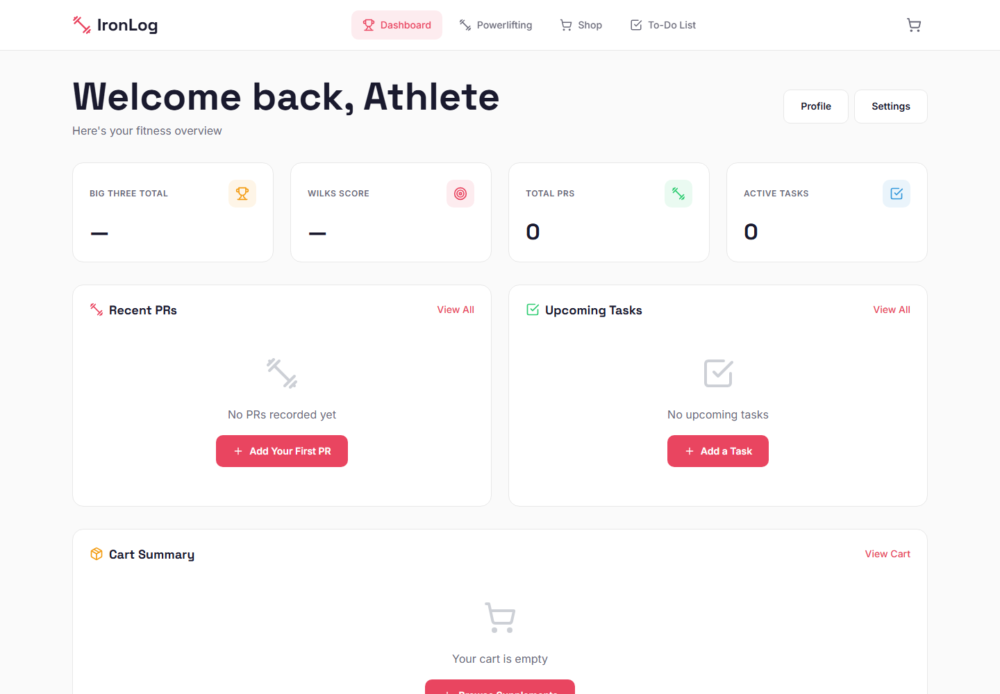
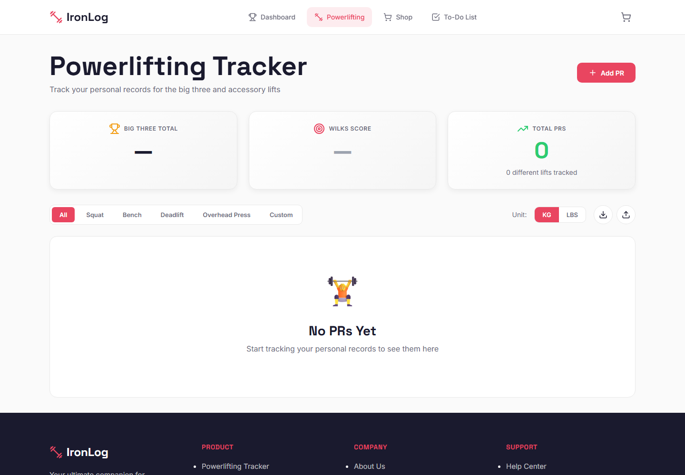
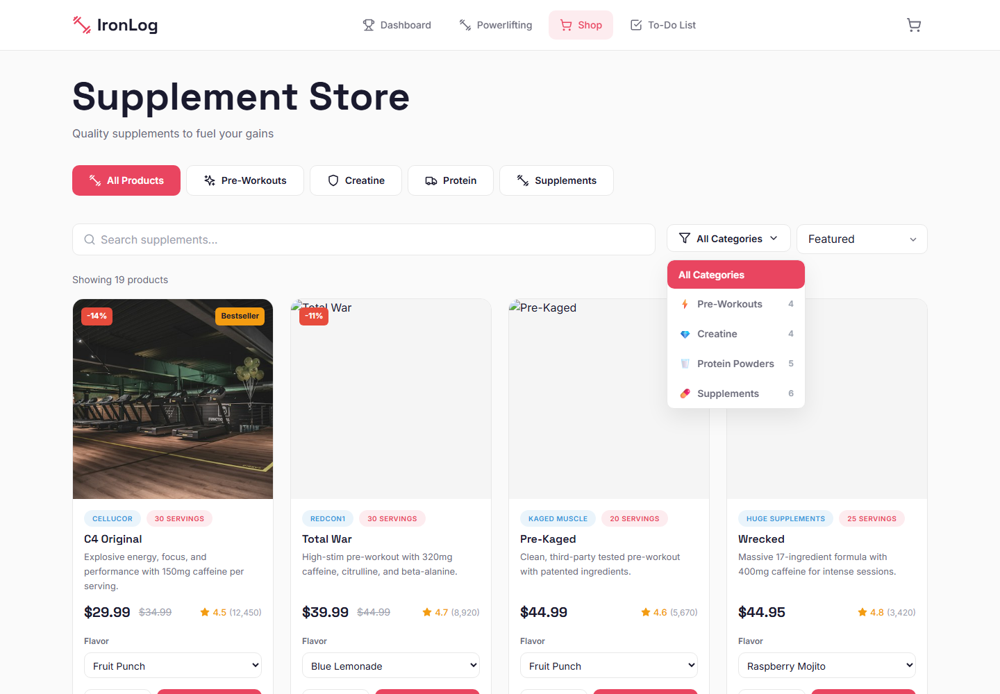
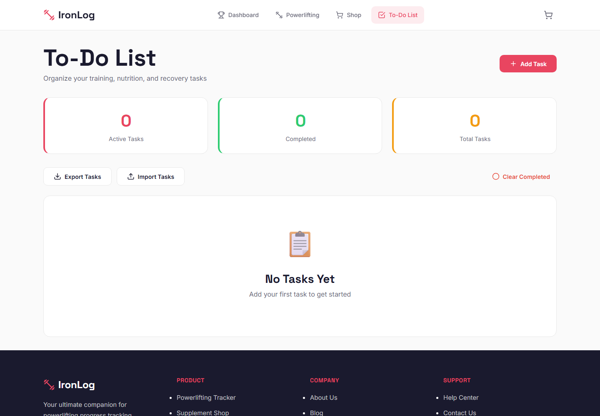
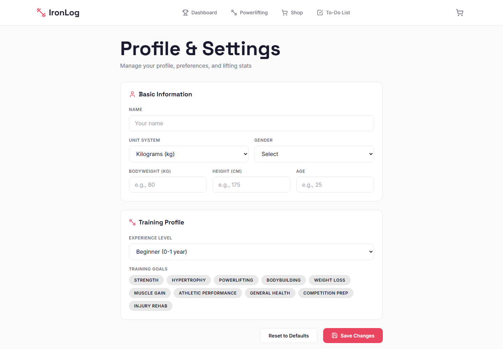

# IronLog — Powerlifting & Fitness Tracker

A clean, minimal, light-themed fitness tracker built with **React + Vite**. IronLog combines a powerlifting PR log, a supplement store, and a box-style task board in one fast, offline-friendly app.

Everything is stored in the browser with **LocalStorage** — no backend, no database, no account required.



---

## Table of Contents

- [Overview](#overview)
- [Features](#features)
- [Tech Stack](#tech-stack)
- [Screenshots](#screenshots)
- [Getting Started](#getting-started)
- [Available Scripts](#available-scripts)
- [Routes](#routes)
- [Project Structure](#project-structure)
- [Data & LocalStorage](#data--localstorage)
- [Strength Formulas](#strength-formulas)
- [Owners](#owners)
- [Push to GitHub](#push-to-github)
- [Notes & Limitations](#notes--limitations)

---

## Overview

IronLog was built for lifters who want a focused training dashboard without signing up for anything. Track your latest PRs per lift, review estimated one-rep maxes and Wilks scores, restock your supplements, and keep your training, nutrition, and recovery tasks organized.

- **Light, minimal UI** — Inter + Space Grotesk typography, soft cards, and a neutral palette.
- **Fully client-side** — data persists in LocalStorage and survives refreshes.
- **Responsive** — works on desktop, tablet, and mobile.
- **Portable data** — export and import your PRs and tasks as JSON.

---

## Features

### Dashboard
- At-a-glance stats: total PRs, best lifts, estimated total, and Wilks score.
- Recent PR activity and open task summary.
- Quick links into each section of the app.

### Powerlifting PR Tracker
- Log a PR for **Squat**, **Bench Press**, **Deadlift**, **Overhead Press**, or a **custom lift**.
- Record weight, unit (`kg` / `lbs`), reps, date, and an optional note.
- Automatic **estimated 1RM** using the Epley formula.
- **Wilks score** calculation from your best lifts and bodyweight.
- Filter the PR list by lift.
- Edit or delete any PR entry.
- Export PRs to JSON and re-import them later.
- Unit preference is shared with your profile.

### Supplement Store
- 19 products across four categories:
  - **Pre-Workouts** — C4 Original, Total War, Pre-Kaged, Wrecked
  - **Creatine** — Creatine Monohydrate, Creapure Creatine, Creatine HCL, Crea-TEN
  - **Protein** — Gold Standard 100% Whey, Dymatize ISO100, Combat Protein Powder, and more
  - **Supplements** — support products for recovery, health, and performance
- Category tabs and a slide-out cart.
- Quantity controls, live totals, and formatted USD pricing.
- Demo checkout that clears the cart and confirms the order.

### Box-Style To-Do List
- Card-based task board with a clean box design.
- Title, description, category (**Workout**, **Nutrition**, **Recovery**, **General**), priority (**Low**, **Medium**, **High**), and due date.
- Mark tasks complete, edit, or delete them.
- Active / completed counts, filtering, and "clear completed".
- Export and import tasks as JSON.

### Profile & Settings
- Name, unit preference, bodyweight, height, age, gender, experience level, and goals.
- Equipment/experience presets from beginner to elite.
- **Danger zone** actions to clear PRs, tasks, or cart, reset the profile, or reset everything.
- All changes persist automatically.

---

## Tech Stack

| Layer | Choice |
| --- | --- |
| UI | React 18 |
| Build tool | Vite 5 |
| Routing | React Router v6 |
| Icons | lucide-react |
| State | React Context + `useReducer` |
| Persistence | Browser LocalStorage |
| Styling | Hand-written CSS design system (Inter + Space Grotesk) |
| Language | JavaScript (JSX) |

No backend, API keys, or environment variables are required.

---

## Screenshots

| PR Tracker | Supplement Store |
| --- | --- |
|  |  |

| To-Do Board | Profile & Settings |
| --- | --- |
|  |  |

---

## Getting Started

### Prerequisites
- **Node.js** 18 or newer
- **npm** 9 or newer

### Install and run

```bash
# from the project folder
npm install
npm run dev
```

Vite starts on **http://localhost:3000** and opens the app automatically.

### Production build

```bash
npm run build
npm run preview
```

The production bundle is written to `dist/`.

---

## Available Scripts

| Command | Description |
| --- | --- |
| `npm run dev` | Start the Vite dev server at `http://localhost:3000` |
| `npm run build` | Create an optimized production build in `dist/` |
| `npm run preview` | Serve the production build locally |

---

## Routes

| Route | Page |
| --- | --- |
| `/` | Dashboard |
| `/powerlifting` | PR tracker and stats |
| `/shop` | Supplement store |
| `/todo` | Box-style task board |
| `/profile` | Profile & settings |
| `/settings` | Alias for the profile page |
| `*` | Redirects to `/` |

---

## Project Structure

```text
fitness-tracker/
├── docs/
│   └── screenshots/          # README screenshots
├── public/
├── src/
│   ├── components/
│   │   ├── layout/           # Header, Footer, Layout (router outlet)
│   │   ├── powerlifting/     # PRForm, PRList, PRStats
│   │   ├── shopping/         # ProductCard, ProductGrid, CartSidebar
│   │   ├── todo/             # TodoForm, TodoItem, TodoList
│   │   └── ui/               # Toast notifications
│   ├── context/
│   │   └── AppContext.jsx    # Global state, reducer, LocalStorage sync
│   ├── hooks/
│   ├── pages/                # Dashboard, Powerlifting, Shopping, Todo, Profile
│   ├── styles/
│   │   └── index.css         # Design tokens and global styles
│   ├── utils/
│   │   ├── helpers.js        # Formatting, 1RM, Wilks, labels
│   │   └── products.js       # Static supplement catalog
│   ├── App.jsx               # Route definitions
│   └── main.jsx              # App entry point
├── index.html
├── package.json
├── vite.config.js
└── README.md
```

---

## Data & LocalStorage

All state is saved under namespaced LocalStorage keys:

| Key | Contents |
| --- | --- |
| `ironlog_prs` | Array of PR entries |
| `ironlog_todos` | Array of task cards |
| `ironlog_cart` | Cart items and quantities |
| `ironlog_profile` | Profile fields and unit preference |

Example PR record:

```json
{
  "id": "1712345678901-a1b2c3d4e",
  "lift": "squat",
  "customLiftName": "",
  "weight": 180,
  "unit": "kg",
  "reps": 3,
  "date": "2026-10-28",
  "note": "Felt strong, depth was clean"
}
```

Example task record:

```json
{
  "id": "1712345678901-x9y8z7w6v",
  "title": "Mobility session",
  "description": "20 minutes of hip and ankle work",
  "category": "recovery",
  "priority": "medium",
  "dueDate": "2026-11-03",
  "completed": false
}
```

Because storage is per-browser, clearing site data removes your entries. Use the export buttons on the PR and To-Do pages to keep backups.

---

## Strength Formulas

- **Estimated 1RM (Epley):** `weight × (1 + reps / 30)`, with a single rep returning the weight itself.
- **Wilks score:** computed from the best Squat, Bench, and Deadlift entries plus your profile bodyweight. Add a bodyweight in **Profile** for a meaningful score.

These are estimates for tracking progress — not competition results.

---

## Owners

This project is owned and maintained by:

| Name | Role |
| --- | --- |
| **Shashidhar** | Owner |
| **bms** | Owner |

> These are the project owners' credentials/identities. IronLog has **no login or authentication system** — it is a client-side app, so no usernames or passwords are stored or required to use it.

---

## Push to GitHub

Target repository: **https://github.com/shashi-texh/iron-log.git**

The commands requested for the initial push:

```bash
echo "# iron-log" >> README.md
git init
git add README.md
git commit -m "first commit"
git branch -M main
git remote add origin https://github.com/shashi-texh/iron-log.git
git push -u origin main
```

### Important

- `README.md` already exists, so `echo "# iron-log" >> README.md` would **append a second title**. Skip that line if you want to keep this README clean.
- `git add README.md` stages **only** the README. To push the whole app, stage everything with `git add .` before committing.

### Recommended full-project push

```bash
git init
git add .
git commit -m "first commit"
git branch -M main
git remote add origin https://github.com/shashi-texh/iron-log.git
git push -u origin main
```

If the remote was already added, use:

```bash
git remote set-url origin https://github.com/shashi-texh/iron-log.git
git push -u origin main
```

A `.gitignore` is included so `node_modules/`, `dist/`, logs, and local environment files are not committed.

---

## Notes & Limitations

- **No backend or authentication.** All data lives in the browser.
- **Checkout is a demo.** It calculates totals, clears the cart, and shows a confirmation — no payment is processed.
- **Product catalog is static** and defined in `src/utils/products.js`; prices and stock are illustrative.
- **Units:** choose `kg` or `lbs` in the PR tracker or profile. Values are stored as entered.
- **Data portability:** use JSON export/import on the PR and To-Do pages. Cart and profile are not exported.

---

## Credits

Built with React, Vite, React Router, and lucide-react. Fonts: Inter and Space Grotesk via Google Fonts.

© 2026 Shashidhar & bms. All rights reserved.
